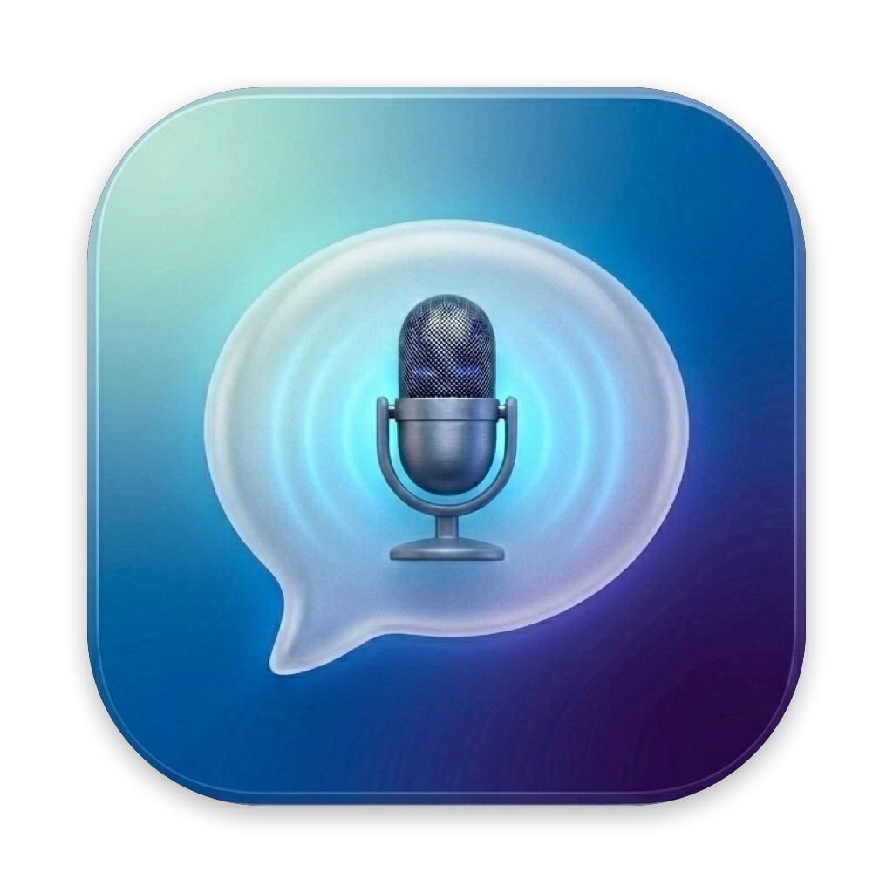
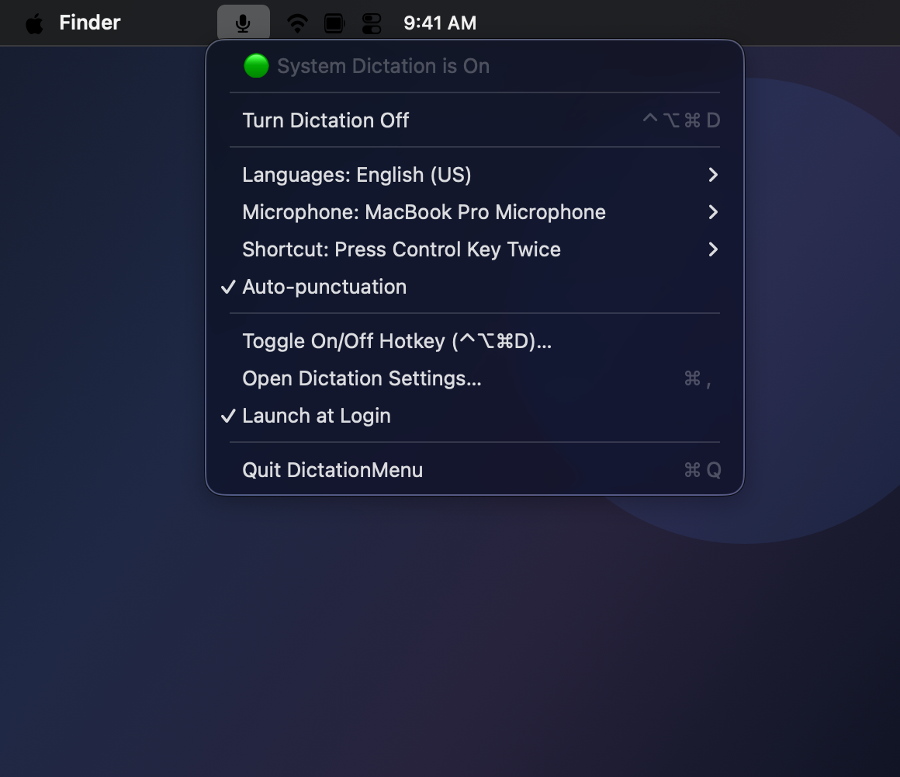
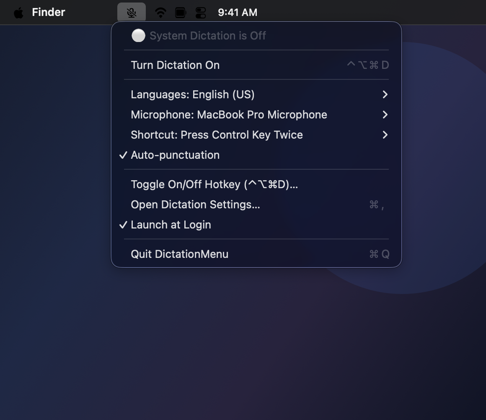

<p align="center">
  
</p>

<h1 align="center">DictationMenu for macOS</h1>

<p align="center">
  A lightweight, native macOS menubar app that lets you view, configure, and toggle <strong>macOS System Dictation</strong> (<code>System Settings &gt; Keyboard &gt; Dictation</code>) with a single click or a customizable global keyboard shortcut.
</p>

<p align="center">
  <a href="Distribution/MacOS%20Dictation%20menu.dmg">
    
  </a>
  <a href="https://github.com/atomikid/macos-dictation-menu/raw/main/Distribution/MacOS%20Dictation%20menu.dmg">
    
  </a>
</p>

---

## 📥 Direct Download

You can download the latest pre-built application directly:

👉 **[Download MacOS Dictation menu.dmg](Distribution/MacOS%20Dictation%20menu.dmg)** ([Direct Download](https://github.com/atomikid/macos-dictation-menu/raw/main/Distribution/MacOS%20Dictation%20menu.dmg))

1. Open `Distribution/MacOS Dictation menu.dmg` (double-click the `.dmg` file to mount it).
2. Drag `DictationMenu.app` into your `/Applications` folder.
3. Open `DictationMenu.app` from `/Applications` (or Spotlight / Raycast).

> **Note on First Launch:** Since the app is built and distributed directly, macOS Gatekeeper may prompt you on first launch. Right-click (or Control-click) `DictationMenu.app` and choose **Open**, then click **Open** in the confirmation dialog.

---

## 📸 Screenshots

<p align="center">
  
  &nbsp;
  
</p>

<p align="center">
  <em>Left: Menubar menu when System Dictation is enabled (<code>mic.fill</code>). Right: Menubar menu when System Dictation is disabled (<code>mic.slash</code>).</em>
</p>

---

## 💻 System Requirements

| Requirement | Specification |
| :--- | :--- |
| **Operating System** | macOS 13.0 (Ventura) or later (macOS 13 Ventura, macOS 14 Sonoma, macOS 15 Sequoia, and newer) |
| **Architecture** | Apple Silicon (M1 / M2 / M3 / M4) and Intel Macs |
| **Dictation** | macOS System Dictation supported (`System Settings > Keyboard > Dictation`) |
| **Permissions** | **No Accessibility permissions needed!** Global hotkeys work system-wide without special security entitlements |

---

## ✨ Features

- **Menubar Status Icon**: Dynamic status indicator in your menu bar — displays `mic.fill` when macOS System Dictation is active and `mic.slash` when disabled.
- **One-Click Toggle**: Enable or disable macOS System Dictation instantly from the menu bar without opening System Settings.
- **Global Keyboard Shortcut**: Defaults to **Control + Option + Command + D (`⌃⌥⌘D`)** to toggle Dictation on and off anywhere, inside any application.
- **Custom Shortcut Recorder**: Record any modifier + key combination via **Toggle On/Off Hotkey…** to suit your personal keyboard preferences.
- **Complete System Dictation Controls**:
  - 🌐 **Languages**: Quick-switch active dictation languages and enable additional installed locales.
  - 🎙️ **Microphone Source**: Select input microphone directly (Automatic, built-in, AirPods, USB audio interfaces, or external mics).
  - ⌨️ **System Dictation Shortcut**: Configure the native macOS dictation invocation key (e.g., Press 🎤 Dictation Key, Press Control Key Twice, Press Fn Twice, Press Command Twice, Custom, or Off).
  - ✍️ **Auto-Punctuation**: Toggle macOS automatic punctuation on or off with a single click.
- **Real-Time Sync**: Automatically reflects the menubar icon and menu state if Dictation is changed outside the app in macOS System Settings.
- **Launch at Login**: Enable or disable launch on system startup directly from the menu.

---

## 🛠️ Building & Running from Source

If you prefer to compile the application bundle yourself:

### 1. Clone the Repository

```bash
git clone https://github.com/atomikid/macos-dictation-menu.git
cd macos-dictation-menu
```

### 2. Build the Application Bundle

Run the provided build script:

```bash
./build.sh
```

This compiles all Swift sources, packages the application icon (`AppIcon.icns`), generates the `Info.plist`, and outputs a signed bundle at `build/DictationMenu.app`.

### 3. Launch or Install

Run the freshly compiled app:

```bash
open build/DictationMenu.app
```

Or install it to `/Applications`:

```bash
cp -R build/DictationMenu.app /Applications/
open /Applications/DictationMenu.app
```

---

## 📄 License

This project is licensed under the MIT License.

